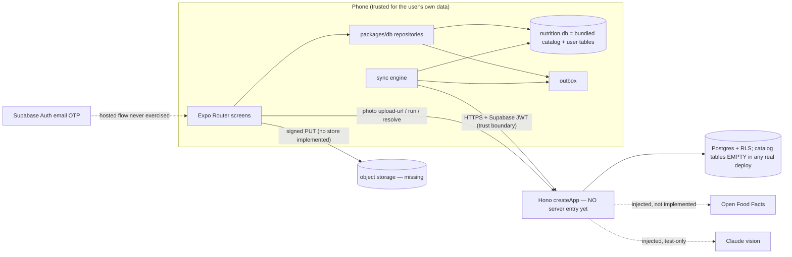

# Codebase Audit and MVP Plan — Nutrition Tracker

| | |
|---|---|
| Audit date | 2026-10-20 |
| Audited commit | `ab0bb2c59e023f0091495adc2b63d5abe1f6a459` ("Implement Milestone 4: photo analysis of meals") |
| Branch | `milestone-4-photo-analysis` (tracking `origin/milestone-4-photo-analysis`) |
| Working tree at start | clean (`git status --porcelain` empty) |
| Working tree at end | clean except this new file, `docs/CODEBASE_AUDIT_AND_MVP_PLAN.md` |
| Method | Lead auditor + five parallel specialist agents (product/mobile, nutrition/local data, API/sync/security, photo analysis, verification/release). Every finding below was either read in source by the lead, or reproduced by a probe script run by the lead or an agent. Agent claims that did not survive checking were dropped (see §11). |
| Scope rule | Audit and planning only. No application code, tests, dependencies, configuration, migrations or assets were changed. |

---

## 1. Executive assessment

**What the product does today.** It is a local-first Expo app with a substantial, carefully engineered core:
- A decimal nutrition engine (`packages/core`) and an SQLite data layer with an atomic outbox (`packages/db`).
- A 13,566-food bundled USDA catalog that rebuilds byte-for-byte.
- Screens for Today, Log sheet, Amount, Water, Quick add, Custom food, Recipes, Goals, History/trends, Provenance, Barcode and Photo.
- A Hono + Postgres API with row-level security, sync, barcode, export, deletion and photo-analysis routes.
- A Claude-based vision adapter and an offline evaluation harness.

**What is demonstrably working**, all on a developer machine:
- Typecheck and lint pass on all 7 packages.
- 346 automated tests run; all pass except one performance assertion.
- The app bundles for iOS and Android.
- Real Postgres RLS tests pass, so user B cannot read or write user A's rows, in SQL or through the API.
- The decimal engine, snapshots, dated goals, missing-≠-zero day totals, catalog sanity checks and reproducible catalog builds all hold up under probes.
- The AI boundary holds in code:
  - The model schema has no nutrient fields.
  - Model output is Zod-validated and checked for nutrient keys.
  - Candidate calories come only from the catalog.

**Largest risks.**
1. **Data correctness in the offline core (blocks the offline MVP):**
   - Ordinary number entry can corrupt or crash a day:
     - A comma decimal is logged ×10.
     - "." crashes a screen.
     - A cleared quick-add amount bricks the day view on every launch.
   - Several one-tap actions write to the wrong day:
     - re-logging a recent food
     - the water chip
     - the "today" view across midnight.
   - Trends treat missing nutrients as zero.
2. **Sync can lose or wedge data (blocks any account/sync launch):**
   - A lost push response plus a new entry silently drops that entry (reproduced).
   - One scanned barcode food stops every other device from ever pulling again (reproduced).
   - Several constraint mismatches make a push batch fail forever.
   - Signing out and in as someone else mixes two people's data.
3. **The server is not runnable:**
   - `apps/api` has no entry point (`src/server.ts` is missing), reads no environment variables and has no deploy target.
   - There is no object storage, no server-side food catalog and no Open Food Facts client.
   - So barcode, sync, export/delete and photo analysis exist only inside the test harness.
4. **Photo analysis is not launchable:**
   - Beyond the wiring gap, the "search for this food" path for an unmatched item throws.
   - Images are never actually deleted.
   - Upload validation is absent.
   - There is no labeled evaluation dataset (4 hand-written meals versus the spec's 100 weighed ones).
5. **CI as committed is red:**
   - The engine coverage gate fails (77% lines; the README claims 100%).
   - The search performance test fails on this machine.

**Readiness.**

| Target | Verdict |
|---|---|
| Original offline MVP (spec Phase 1, personal use, no account) | **Not ready, but close.** The blockers are small, local fixes (WP-1, WP-2), plus the spec's own exit criteria: two weeks of daily use, speed targets and the accessibility checklist, none of which has been run. |
| Account/sync release (Phase 2–3 scope, multi-device) | **Not ready.** It needs a runnable API, hosted Supabase validation and sync correctness fixes (WP-3 to WP-6). |
| AI-enabled launch (Phase 4 beta, then Phase 5 outside testers) | **Not ready.** It needs everything above plus the storage pipeline, retention, upload validation, the review-flow fix, live-model validation and a real labeled dataset (WP-7 to WP-9). |

**Evidence limits.**
- No real device, simulator session, hosted Supabase project, live model call or physical barcode was used.
- Performance numbers come from a heavily loaded developer Mac (load average around 14–19 during the runs).
- Catalog reproducibility from network sources (`catalog:fetch` + `catalog:build`) was not run, because it would rewrite the tracked asset.
- This audit is broad but not exhaustive; §11 lists what was not inspected.

---

## 2. Original goals and scope

### 2.1 Sources

| Source | Availability | Notes |
|---|---|---|
| *Nutrition Tracker — Product & Architecture Spec* (README link `https://claude.ai/artifact/27veyRAvDFfsyEg52tw4b9`) | **Read in full** through the Claude Docs connector | Dated 2026-09-20, revision 15. Sections 1–8: PRD, architecture, schema, API, UI/UX, testing/CI/CD, phased roadmap, internal review log R1–R14. Quotes below use its section numbers. |
| `README.md` | Read | Claims Phases 0–3 are done and says photo analysis is "Not yet — Phase 4". Stale; see AUD-032. |
| Commit messages bd31fdd → ab0bb2c | Read | Milestones 1–4. M4 adds photo analysis. |
| `.github/workflows/ci.yml`, package manifests, `pnpm-workspace.yaml` | Read | |
| `AGENTS.md` / `CLAUDE.md` | **None exist** in the repository | |
| `tools/photo-eval/fixtures/README.md` | Read | States the recorded responses are hand-written and establish nothing about model accuracy. |

### 2.2 Product intent and users (explicit, spec §1)

- **Problem:** existing trackers are slow, cluttered and mix verified with crowd data. AI photo loggers "invent calorie numbers with false precision".
- **Primary user:** "one person (the builder) tracking calories, macros and water daily."
- **Later users:** "privacy-conscious adults". Clinical use is an explicit non-goal.
- **Headline goal:** "a repeat meal loggable in three taps and a new food in under ten seconds, with numbers the user can trust and trace."

### 2.3 Explicit requirements (spec §1, with priorities)

- **P0:**
  - F1 dated, versioned goals
  - F2 search with recents and frequents first
  - F3 log in g / mL / household unit
  - F4 meal slots and copy yesterday
  - F5 Today view
  - F6 water
  - F7 custom food from label
  - F8 offline logging and generic search
- **P1:**
  - F9 barcode
  - F10 account and multi-device sync
  - F11 recipes
  - F12 history and 7/30-day trends
  - F14 export and account deletion: "P1 (required before any other user)"
- **P2:** F13 photo → reviewable draft → confirm.
- **P3:** F15 label OCR.

**Non-functional requirements:**
- Deterministic totals on every device.
- Every nutrient on screen traceable to source, record ID and release.
- Honest uncertainty for AI amounts.
- Private: owner-only images and logs, no third-party trackers.

**Core invariants** (spec Summary, §2.6, §2.7, §3.7):
- AI never supplies nutrient values or household-portion weights.
- Missing ≠ zero.
- Decimal arithmetic, with decimal strings on the wire.
- A snapshot is taken on log.
- Goals are dated.
- Photo tables hold no nutrient values.

**Measurable acceptance criteria** (spec §1 metrics, §2.13 budgets, §5.4 tap targets, §7 exit criteria):

| Phase | Exit criteria |
|---|---|
| 0 | Engine at 100% branch coverage; golden tests pass; catalog < 15 MB compressed |
| 1 | Two weeks of daily personal use; §5.4 speed targets met; accessibility checklist passes |
| 2 | Two devices show identical totals after offline edits on both; RLS tests pass; export round-trips |
| 3 | §2.13 budgets met on a mid-range Android phone |
| 4 | Eval baseline recorded on 100 labeled meals; 0 nutrient fields from the model; images deleted on schedule, verified by test |
| 5 | Restore drill; security checklist; TestFlight with 5–10 outside testers |

### 2.4 Offline MVP versus later phases

The spec defines the **offline MVP as Phase 1**: Today, Log sheet, local search, amount step, meals, water, goals, custom foods, quick add and a history list, with no account. §2.9 also states that local mode is a permanent, supported mode: "full manual logging, offline, no sync, no AI". Accounts, sync, barcode and export/delete belong to Phase 2. Recipes and trends belong to Phase 3. Photo analysis is a Phase 4 *beta*. Production hardening and the first outside testers come in Phase 5.

### 2.5 Is AI photo analysis required for launch?

**Explicitly, no for the offline MVP.** F13 is P2. Local mode excludes AI. Phase 1 has no AI scope.

**For the first release to other people, it is ambiguous.** The spec's dependency graph makes Phase 5 (hardening + outside testers) depend on *both* Phase 3 and Phase 4. That implies the first outside-tester build includes the photo beta. But F14, not F13, is the item marked "required before any other user". The photo success metric ("≥ 70% accepted without changing the food") is also to be "measured in beta".

**Decision needed (D-1):** whether the first outside-tester release ships with photo analysis enabled, shipped hidden behind a flag, or deferred. This report therefore gives conditional plans (§8): **Track A** is the offline personal MVP; **Track B** adds accounts/sync; **Track C** is AI-enabled.

### 2.6 Inferred requirements (not stated in the spec)

These come from the evidence, not from the spec, and are labeled "inferred" wherever they are used:
- **Locale-safe number entry.** The spec assumes a US-centric catalog but does not mention input locales.
- **Explicit account-binding of the local database.** The spec covers local→account adoption but not account switching.
- **Crash-free handling of malformed persisted rows.**

### 2.7 Conflicts between goals, documentation and implementation

| Conflict | Evidence |
|---|---|
| README says photo analysis is "Not yet — Phase 4" and "There is no model call anywhere in this milestone", but M4 adds a reachable Photo button, routes, a real SDK call and screens. | `README.md:34,104`; `apps/mobile/app/log.tsx:214`; `apps/api/src/vision/claude.ts:56` |
| README claims 100% branch coverage ("the Phase 0 gate"), but the gate fails. | `README.md:77`; AUD-028 |
| README says "253 tests"; the actual count is 346. | `README.md:76` |
| README presents F9, F10 and F14 as "Done", but there is no runnable server, and deletion and export are incomplete. | AUD-016, AUD-019, AUD-020 |
| Spec §3.2 sets energy priority `{1008, 2047, 2048}`; the code declares `[1008, 2048, 2047]` and applies neither. | AUD-009 |
| Spec §4.2 export is a signed zip; the implementation returns inline JSON. This is a documented deviation. | `README.md` "Deviations" |
| Spec §2.9 requires Apple, Google and email sign-in; only email OTP exists. This is a documented deviation. | `apps/mobile/src/auth/supabase.ts` |
| Camera permission text says "Photos are never taken or stored", but the app now takes and uploads photos. | `apps/mobile/app.json:14,28`; AUD-027 |

---

## 3. Repository and architecture overview

| Component | Role | Notes |
|---|---|---|
| `packages/core` | Engine: nutrient codes, decimal math (`decimal.js`), units, totals, goals, normalization (FDC/OFF), formatting, Zod sync contracts, photo model schema, label matching | Imported by app, API and tools |
| `packages/db` | SQLite schema (checked-in SQL in `migrations/`, generated into `src/migrations.generated.ts`), Drizzle mirror, repositories, day reader, client sync engine (outbox push, cursor pull) | Runs on expo-sqlite on device and better-sqlite3 in tests and tools |
| `packages/tokens` | Design tokens | |
| `apps/mobile` | Expo SDK 57 / RN 0.86 / Expo Router app | Catalog asset is copied into place as the **user database** on first launch |
| `apps/api` | Hono app factory (`createApp`) on Postgres with RLS; routes for foods, barcode, sync, me (export/delete), photos; Claude adapter | **No entry point, no env reading, no deploy config** |
| `tools/fdc-import` | Builds the bundled catalog from pinned FDC bulk files or committed fixtures | Default output path is the tracked asset |
| `tools/photo-eval` | Offline eval metrics over hand-written recordings | No live mode implemented |
| `fixtures/` | Golden-test FDC/OFF records | |
| CI | `ci.yml` jobs: check (typecheck, lint, test, coverage, catalog fetch/build/reproducibility, fixture seed), bundle (iOS export), secrets (gitleaks) | No deploy, OpenAPI, dependency audit, E2E or eval |



**Trust boundaries.**
- **Device → API:** the JWT is checked in `apps/api/src/auth.ts`, then Postgres re-checks it per transaction with `set_config('app.user_id', …, true)` and `set local role app_api` (`apps/api/src/db.ts:33-48`).
- **Model → API:** untrusted output, schema-validated in `apps/api/src/vision/claude.ts:116-127`.
- **Server → device on pull:** rows are applied *without* validation (`packages/db/src/sync/apply.ts`). This matters for AUD-003 and AUD-007.

**Runtime dependencies that must exist before any non-local feature works:**
- a Supabase project (Auth, Postgres, Storage)
- a server process or Edge Function
- `DATABASE_URL`
- a JWT secret or JWKS
- `ANTHROPIC_API_KEY` (read implicitly by the SDK)
- storage credentials
- a scheduler for the retention sweeper and tombstone purge
- a server-side catalog import

None of these is configured or documented in the repository.

---

## 4. Requirements traceability matrix

**Status key:**
- **Verified:** implemented and checked by tests or probes in this audit.
- **Partial:** partially implemented.
- **Impl-unverified:** implemented but not verified.
- **Missing.**
- **Deferred:** deferred by the original scope.
- **Unknown.**

| Requirement / source | Implementation evidence | Verification evidence | Status | Gap / next action |
|---|---|---|---|---|
| F1 Goals: dated, versioned, g or % | `packages/db/src/repositories/goals.ts:58-87`; `apps/mobile/app/goals.tsx`; `packages/core/src/goals.ts` (4/4/9) | db tests; probe: two same-day saves update one profile, a pre-goal day returns null | Partial | AUD-034: blank → 0 target, no validation. AUD-007: "." crashes render. |
| F2 Search; recents and frequents first | `packages/db/src/repositories/foods.ts`; `apps/mobile/app/log.tsx:48-69` | FTS probe: 17 hostile inputs, none throw | Verified (local) | Remote branded search not implemented (needs AUD-017). |
| F3 Log in g / mL / portion | `packages/core/src/units.ts:52,74`; `apps/mobile/app/amount.tsx` | units tests | Partial | AUD-031: density is always null, so mL is never available. |
| F4 Meal slots; copy yesterday | `apps/mobile/src/components/MealSection.tsx:45-62`; `entries.copyMeal` keeps the snapshot | repo tests | Partial | Copy appears only on empty meals and has no undo (AUD-035). |
| F5 Today: totals, remaining, per meal | `apps/mobile/src/components/DayView.tsx`; `packages/core/src/totals.ts` | db-reactivity, a11y tests | Partial | AUD-008: wrong day after midnight. |
| F6 Water presets and custom | `WaterRow.tsx`; `apps/mobile/app/water.tsx`; schema CHECK 1–5000 | probe: CHECK holds, but 1.5 is stored as REAL | Partial | AUD-008: the chip ignores the viewed date. |
| F7 Custom food from label | `packages/core/src/custom-food.ts`; `apps/mobile/app/custom-food.tsx` | core tests | Partial | AUD-007 input handling; no edit path. |
| F8 Offline logging and search | No network in local paths; `apps/mobile/src/config.ts` local mode | Code reading; bundle passes | Impl-unverified | Needs an on-device run (WP-10). |
| F9 Barcode → branded food | `apps/api/src/routes/foods.ts:137-173`; `apps/mobile/app/scan.tsx` | api tests with a stubbed upstream | Partial | AUD-017 (no upstream, empty catalog), AUD-012 (provenance), AUD-022 (cache poisoning), AUD-035 (scanner UX). |
| F10 Account, multi-device sync | `apps/api/src/routes/sync.ts`; `packages/db/src/sync/*`; `apps/mobile/src/sync/provider.tsx` | convergence tests (one user, fake transport); lead reproduced AUD-001, AUD-002, AUD-005 | Partial | AUD-001 to AUD-006, AUD-016, AUD-021. |
| F11 Recipes | `packages/core/src/recipe.ts`; `packages/db/src/repositories/recipes.ts` | recipes tests; probe | Partial | AUD-011. |
| F12 History, 7/30-day trends | `apps/mobile/app/(tabs)/history.tsx`; `TrendChart.tsx` | trends.test.tsx | Partial | AUD-010. |
| F13 Photo → draft → confirm | photo routes, adapter, `photo.tsx`, `photo-review.tsx`, `draft.ts` | Mocked tests only | Partial | AUD-015, AUD-016, AUD-018, AUD-023 to AUD-026. |
| F14 Export and deletion | `apps/api/src/routes/me.ts` | convergence round-trip; deletion test counts `log_entry` only | Partial | AUD-019, AUD-020. |
| F15 Label OCR | — | — | Deferred (P3) | — |
| NFR Deterministic | `packages/core/src/decimal.ts`; reproducible catalog | property tests; two identical seed builds | Verified (engine) | AUD-003: non-canonical amounts reach storage. |
| NFR Traceable | `apps/mobile/app/provenance.tsx` | — | Partial | AUD-012. |
| NFR Honest uncertainty | `EntryRow.tsx:72` "Estimated" badge; `draft.ts` ranges | photo-draft tests | Partial | AUD-025: the range is not persisted. |
| NFR Private | RLS (`apps/api/migrations/0001_init.sql:201-208`), no trackers | 13 RLS tests | Partial | AUD-004 (device sharing), AUD-019, AUD-018. |
| §2.6 Missing ≠ zero | `packages/core/src/totals.ts:23-43` | totals tests | Partial | AUD-010 (History). |
| §2.6 Snapshot on log | `packages/db/src/repositories/entries.ts:118-147` | recipes test; probe: day total unchanged after recipe edit | Verified | — |
| §2.6 Nutrient mapping priority | `packages/core/src/normalize.ts:228` | Test masks the bug | Partial | AUD-009. |
| §2.6 Sanity checks and quarantine | `normalize.ts`; `build-catalog.ts` | catalog probe: 0 violations among 13,566 foods | Verified | — |
| §2.7 Model schema has no nutrient fields | `packages/core/src/photo.ts`; `claude.ts:116` | vision tests (mocked) | Impl-unverified live | AUD-024. |
| §2.8 Retention, 24 h deletion | `photos.ts:217-286` (logic only) | Row-selection test only | Missing (operational) | AUD-018. |
| §2.10 Outbox atomicity | Every repository write calls `enqueue` in the same transaction | data-agent read of every write path | Verified | — |
| §2.10 Tombstone purge, 90 days | Watermark read only (`sync.ts:188-196`) | Manual watermark in test | Missing | AUD-029. |
| §2.11 Sentry with PII scrubbing | — | — | Missing | AUD-029. |
| §2.12 RLS on every user table, tested | Migrations 0001, 0003, 0004 | rls.test.ts covers 10 tables (not recipe_* or photo_*) | Partial | Extend the tests (WP-6). |
| §2.12 Upload validation, 5 MB, magic bytes | — | — | Missing | AUD-018. |
| §2.12 Rate limits | `apps/api/src/rate-limit.ts` (in-memory); photo quota in Postgres | api tests | Partial | AUD-029. |
| §2.13 Performance budgets | `packages/db/test/performance.test.ts` | Search p95 12.3 ms vs 10 ms gate (fails under load) | Partial | AUD-028; real-device measurement (WP-10). |
| §4.4 X-App-Version / 426 | Client sends the header only | — | Missing | AUD-029. |
| §5.3 Photo review gating | `draft.ts:57-58,71-77` | photo-draft tests | Partial | AUD-015. |
| §5.4 Speed targets | Recent = 2 taps (`log.tsx:182`) | Tap count from code | Impl-unverified | AUD-008 wrong-day defect on that path; time on device. |
| §5.6 Accessibility | Labels, ring/chart text, 44 pt on Button | a11y tests | Partial | AUD-035; VoiceOver/TalkBack not run. |
| §6.1 Coverage gate 100% | `packages/core/vitest.config.ts` | **Fails** (77.23% lines) | Missing | AUD-028. |
| §6.1 Contract (OpenAPI) | — | — | Missing | Post-MVP (WP-12). |
| §6.1 E2E (Maestro) | — | — | Missing | WP-10. |
| §6.3 CD | — | — | Missing | AUD-016, AUD-030. |
| Phase 2 exit: identical totals on two devices | convergence.test.ts | Happy path passes; AUD-002 breaks it in practice | Partial | WP-4. |
| Phase 4 exit: eval baseline on 100 meals | 4 hand-written meals | — | Missing | WP-9. |

---

## 5. Verification results

**Environment:**
- macOS (Darwin 25.6.0), Node v22.6.0, pnpm 12.5.1, dependencies pre-installed.
- No `DATABASE_URL`, `ANTHROPIC_API_KEY` or Supabase variables in the environment.
- The API tests started embedded Postgres.
- Load average was 14–19 during the runs, because the agents ran concurrently.

| # | Command | Run by | Exit | Result | Classification |
|---|---|---|---|---|---|
| 1 | `pnpm -r run typecheck` | lead + verification agent | 0 | 7/7 packages clean (about 21 s) | Passed |
| 2 | `pnpm lint` | lead + verification agent | 0 | No findings | Passed |
| 3 | `pnpm --filter @nt/core test` | lead + verification agent | 0 | 17 files, 148 tests | Passed |
| 4 | `pnpm --filter @nt/core run test:coverage` | lead (reproduced) | **1** | Lines/statements 77.23%, functions 97.67%, branches 99.6%. `photo.ts`, `matching.ts` and `sync-contracts.ts` are at 0% because they are only exercised from `apps/api` tests. | **Failed: repository defect** (AUD-028) |
| 5 | `pnpm --filter @nt/db test` | verification agent, 3 runs; lead re-ran the perf file | 1 | 70 passed, 1 failed: `searches inside the per-keystroke budget` — "p95 12.3ms; slowest "co" 19.8ms: expected … to be less than 10". Agent runs gave 14.8 / 11.8 / 12.3 ms. | **Failed.** Partly environmental (heavy load), but an independent agent probe measured p95 11.6 ms deterministically on a catalog copy, so the 10 ms gate is genuinely marginal (AUD-028). |
| 6 | `pnpm --filter @nt/fdc-import test` | verification agent | 0 | 8 tests | Passed |
| 7 | `pnpm --filter @nt/photo-eval test` | verification agent | 0 | 16 tests (metric code only) | Passed |
| 8 | `pnpm --filter @nt/mobile test` (jest) | verification agent | 0 | 5 suites, 35 tests | Passed |
| 9 | `pnpm --filter @nt/api test` | verification agent | 0 | 5 files, 68 tests on embedded Postgres | Passed |
| 10 | `expo export --platform ios` / `--platform android` into scratch | verification agent | 0 / 0 | 2,110 / 2,204 modules bundled | Passed |
| 11 | `pnpm catalog:seed -- --out=<scratch>` (twice) | data + verification agents | 0 | 583 foods, 10 quarantined; identical SHA1 across builds | Passed |
| 12 | Offline eval via `evaluate()` against a catalog copy | photo agent | 0 | 4 meals; top-1 75%, top-3 100%, MdAPE 13%, 0 schema failures, 0 nutrient leaks | Passed, but **not evidence of model quality**: the responses are hand-written |
| 13 | Sync probes `probe-idem`, `probe-fk`, `probe-pull` (fake server, in-memory SQLite) | API agent; **lead re-ran** | 0 | "server has B? false, outbox pending 0"; "tablet sync FAILED: FOREIGN KEY constraint failed … cursor 0"; an edited note lost after pull | Reproduced defects (AUD-001, AUD-002, AUD-005) |
| 14 | Data probe `probe2.mts` | data agent; **lead re-ran** | 0 | Recipe drops a deleted ingredient (165.9 → 130 kcal/100 g); self-ingredient accepted; goal value `'abc'` and grams `-100` accepted; `readDay` then throws on bad grams | Reproduced defects (AUD-007, AUD-011) |
| 15 | JWT probe `probe-jwt.mts` | API agent | 0 | Empty secret accepts forged tokens; no `exp` accepted; `alg:none` and RS256 rejected | Reproduced (AUD-021, latent) |
| — | `pnpm catalog:fetch` / `catalog:build` (CI reproducibility) | — | — | — | **Not run:** needs network and rewrites a tracked asset |
| — | `pnpm eval:photo` as written | — | — | — | **Not run:** `run.ts:23` opens the tracked catalog directly; an equivalent was run on a copy (row 12) |
| — | Live model, hosted Supabase, device/simulator, physical barcode, VoiceOver/TalkBack, `expo-doctor`, dependency audit | — | — | — | **Blocked:** needs credentials, devices or network |

**Test count:** 148 + 71 + 8 + 16 + 35 + 68 = **346**. The README says 253 and the M4 commit says 288.

**Tracked-file integrity:**
- `shasum apps/mobile/assets/catalog.sqlite*` was unchanged before and after every run.
- `git status --porcelain` was clean after every run.
- Side effects were limited to gitignored paths: `packages/core/coverage/` and `apps/mobile/.expo/`.

**Areas with no automated coverage:**
- screen-level flows: Log, Amount, Entry, Scan, Photo, Photo review, Settings, Sign-in, Goals
- `HttpTransport`
- account switching
- concurrent pushes
- real Supabase tokens
- storage
- the server catalog
- migration upgrade from an older install
- end-to-end flows of any kind

---

## 6. Findings

Findings are ordered by severity, then by dependency. "MVP blocker" refers to the **offline MVP (Track A)** unless stated as conditional on Track B (accounts/sync) or Track C (AI).

### 6.1 Confirmed findings

#### AUD-001 — A reused idempotency key silently drops entries logged after a lost push response
- **Category:** sync / data loss
- **Severity:** high
- **MVP blocker:** conditional (Track B)
- **Confidence:** confirmed (reproduced by the lead)
- **Evidence:**
  - `packages/db/src/sync/engine.ts:70-79`: the key persists until success, but the batch is rebuilt from the current outbox.
  - `apps/api/src/app.ts:92-93`: the server replays the stored response for a known key.
  - `engine.ts:75-77`: the client then deletes every sent sequence number.
- **Trigger:**
  1. Push A commits on the server but the response is lost (timeout or app backgrounded).
  2. The user logs B.
  3. The next sync replays A's response, and B's outbox row is deleted. Probe output: "server has B? false, outbox pending 0".
- **Impact:** an entry vanishes from the server, from other devices and from the export, with no error.
- **Fix direction:**
  - Bind the key to an exact batch: persist the sent sequence numbers with the key and resend exactly those; or delete only the sequence numbers whose rows appear in `response.assigned`.
  - Optionally store a request hash server-side and reject a reused key with a different body (409).
- **Acceptance:** the reproduced scenario keeps B in the outbox and pushes it.
- **Regression:** the probe as an `@nt/db` test, plus an API test for key reuse with a different body.
- **Dependencies:** none.

#### AUD-002 — A food missing on the receiving device permanently wedges pull (scanned branded foods)
- **Category:** sync / schema parity
- **Severity:** high
- **MVP blocker:** conditional (Track B)
- **Confidence:** confirmed (reproduced by the lead)
- **Evidence:**
  - Local `log_entry` has foreign keys on `food_id`, `portion_id` and `source_release_id` (`packages/db/migrations/0001_init.sql:107,110,117`), with `foreign_keys = on` (`packages/db/src/migrations.ts:20`).
  - Scanned foods are cached locally as non-synced (`apps/mobile/app/scan.tsx:86`).
  - Only custom foods and recipes are serialized (`packages/db/src/sync/serialize.ts:92`).
  - The whole pull page is applied in one transaction (`engine.ts:121-123`).
- **Trigger:** device 1 scans and logs a product; device 2 syncs. Probe: "FOREIGN KEY constraint failed … cursor 0" on every retry. Any catalog-release difference between devices triggers the same failure.
- **Impact:** device 2 never receives another change. This breaks the Phase 2 exit criterion in practice.
- **Fix direction:** make every food referenced by a synced entry obtainable on the other device, by one of:
  - syncing scanned and branded foods as aggregates, or
  - fetching missing foods on demand, or
  - not enforcing foreign keys for synced references and resolving lazily.
  
  Also isolate per-row apply failures so one bad row cannot block a page.
- **Acceptance:** a two-device test where one device scans and logs and the other pulls successfully and shows identical totals.
- **Dependencies:** AUD-017 (a server copy of branded foods); the design choice is D-4.

#### AUD-003 — Push batches can fail forever (contract looser than database; unseeded server data; goal collisions; non-canonical amounts)
- **Category:** sync robustness / validation
- **Severity:** high
- **MVP blocker:** conditional (Track B)
- **Confidence:**
  - Confirmed by reading: goal collision, missing seed, Zod/DB mismatch.
  - Confirmed by probe: `".5"` is rejected by the contract.
- **Evidence:**
  - `numericString` regex `^-?\d+(\.\d+)?$` (`packages/core/src/schemas.ts:14-16`) rejects `".5"` but accepts negatives. Meanwhile `NumberField.tsx:71` lets `".5"` through, and `amount.tsx:119` stores the raw text.
  - `upsertFood` throws when no `provider='user'` release exists (`apps/api/src/routes/sync.ts:99-102`). No migration seeds it; only `apps/api/test/harness.ts` does.
  - Goal profiles are unique on `(user_id, effective_from)` on the server and `effective_from` is unique locally, but each device generates a new id (`packages/db/src/repositories/goals.ts:62-69`).
  - Zod accepts values that Postgres CHECKs and foreign keys reject: derivation, portion source, nutrient code, zero or negative grams (`sync-contracts.ts` vs `apps/api/migrations/0001_init.sql:85-95`).
  - The client retries the same first 500 rows every 5 s with no backoff (`apps/mobile/src/sync/provider.tsx:100-104`).
- **Trigger:** any of the following stalls all later changes from that device:
  - logging ".5 g"
  - pushing any custom food to a freshly migrated server
  - saving goals on two devices on the same day before syncing
- **Impact:** a permanent sync stall with only a generic error badge.
- **Fix direction:**
  - Canonicalize numbers at the repository boundary.
  - Align Zod with the database constraints (non-negative, finite, bounded strings, real dates, integer mL).
  - Seed the user `source_release` in a migration.
  - Make goal-profile identity deterministic per `(user, effective_from)`, or merge on conflict.
  - Report per-row rejections instead of failing the batch.
  - Add exponential backoff and a surfaced "stuck item".
- **Acceptance:** each trigger above syncs or is surfaced, and the rest of the outbox continues.
- **Dependencies:** AUD-007 (input canonicalization).

#### AUD-004 — Sign-out keeps everything; signing in as another user mixes accounts and can wedge sync
- **Category:** privacy / data integrity
- **Severity:** high
- **MVP blocker:** conditional (Track B; also before any shared-device use)
- **Confidence:** confirmed by code trace. The Postgres error behaviour in step 4 follows documented `ON CONFLICT` + RLS semantics and is consistent with `apps/api/test/rls.test.ts:93-105` expecting RLS errors.
- **Evidence:**
  - `apps/mobile/src/auth/provider.tsx:35-38` clears only the token.
  - The cursor is a global setting (`packages/db/src/sync/engine.ts:16,27-35`).
  - No owner id is stored locally.
  - The upserts have no `user_id` predicate (`apps/api/src/routes/sync.ts:28` and siblings).
- **Trigger:** A uses the app and syncs, then signs out; B signs in on the same device. Then:
  1. A's unpushed rows are inserted into B's account.
  2. A's rows remain visible to B.
  3. B's pull starts at A's cursor, so B's rows below it are never downloaded (the sequence is global).
  4. B editing an A-origin row hits an RLS error, which returns 500 and wedges sync (as in AUD-003).
  
  Relatedly, account deletion leaves all data on the device (`apps/mobile/app/(tabs)/settings.tsx:89-90`).
- **Impact:** cross-account data exposure on shared devices; incomplete history; stalled sync.
- **Fix direction:**
  - Persist the account id that owns the local database.
  - On sign-in with a different id, require "wipe and continue" or refuse.
  - Reset the cursor and idempotency key on any identity change.
  - Offer "remove data from this device" on sign-out and deletion.
- **Acceptance:** an A → sign-out → B test passes: no A rows under B on the server, B's full history pulled, sync not wedged, A's data not shown.
- **Dependencies:** owner decision D-3 on sign-out semantics.

#### AUD-005 — Pull overwrites local edits made while a sync is in flight
- **Category:** sync correctness
- **Severity:** medium
- **MVP blocker:** conditional (Track B)
- **Confidence:** confirmed (reproduced by the lead; the probe forces the echo by resetting the cursor)
- **Evidence:**
  - `packages/db/src/sync/apply.ts:17-178` upserts pulled rows without checking the outbox.
  - Push does not advance the cursor, so the same sync's pull echoes just-pushed rows (`engine.ts:133-136`).
- **Trigger:** the user edits a row between push completing and pull applying. The edit is reverted locally, and the next push sends the reverted state.
- **Impact:** lost user edits, more likely with the 5 s polling.
- **Fix direction:** skip pulled rows that have pending outbox records, or apply them and re-mark them dirty.
- **Acceptance:** a test that injects a write between `transport.push` and `transport.pull`.
- **Dependencies:** none.

#### AUD-006 — `server_rev` from a sequence is not commit-ordered; concurrent pushes can be skipped by pull
- **Category:** sync correctness
- **Severity:** medium
- **MVP blocker:** conditional (Track B, multiple devices)
- **Confidence:** suspected (reasoned from Postgres sequence semantics; not reproduced)
- **Evidence:**
  - `nextval('server_rev_seq')` is called inside the request transaction (`apps/api/src/routes/sync.ts:39`).
  - Pull reads `server_rev > cursor` (`sync.ts:173-185`).
- **Trigger:** device A's push holds revs 100–150 uncommitted; device B commits 151 and pulls; B's cursor passes 150, and B never sees A's rows.
- **Impact:** a silent divergence between devices.
- **Fix direction:** serialize pushes per user (an advisory lock), or bound pulls by the oldest in-flight transaction (`pg_snapshot_xmin`), or re-read an overlap window.
- **Acceptance:** a two-connection interleaving test.
- **Dependencies:** none.

#### AUD-007 — Number entry can silently scale values ×10, crash screens, or brick a day permanently
- **Category:** input validation / correctness
- **Severity:** **high**
- **MVP blocker:** **yes**
- **Confidence:** confirmed (source plus probes)
- **Evidence:**
  - `apps/mobile/src/components/NumberField.tsx:71` strips everything but `[\d.]`, so "12,5" becomes "125". The `decimal-pad` keyboard emits "," in comma-decimal locales.
  - "." and "1.2.3" survive the sanitizer, and `num`/`resolveGrams` throw during render in `apps/mobile/app/amount.tsx:90-93` and `apps/mobile/app/goals.tsx:103-104`.
  - Editing a quick add stores the raw field text (`apps/mobile/app/entry/[id].tsx:55`). `nutrient-map.ts` then throws on read, so `readDay` throws for that date on every launch (probe: `''`, `'.'`, `'1.2.3'` all brick the day).
  - Repositories accept negative grams and garbage goal values (probe: day total −130; goal value `'abc'`).
  - There is no `ErrorBoundary` anywhere in `apps/mobile/app`, and `DatabaseProvider` rethrows during render (`apps/mobile/src/db/provider.tsx:93`).
- **Impact:** silent 10× logging errors; app crashes; a day that can never be opened again without manual database surgery.
- **Fix direction:**
  - One shared parse/canonicalize helper built on `tryDec`, mapping "," to ".", allowing one separator and returning `null` for invalid input.
  - Repository-boundary validation (finite, ≥ 0 or > 0 as appropriate), with canonical storage via `num()`.
  - Tolerant reads, so a malformed stored value is flagged rather than thrown.
  - Route-level `ErrorBoundary` components.
- **Acceptance:**
  - `changeText('1,5')` gives `"1.5"`.
  - "." never throws.
  - Repository writes of invalid values are rejected.
  - `readDay` survives a corrupt row.
- **Regression:** component tests for NumberField, Amount and Goals; repository tests; a corrupt-row read test.
- **Dependencies:** none. AUD-003 depends on this finding.

#### AUD-008 — Several actions write to the wrong day
- **Category:** time and date correctness
- **Severity:** **high**
- **MVP blocker:** **yes**
- **Confidence:** confirmed (source; repository behaviour probed)
- **Evidence:**
  - One-tap recent re-log calls `logFood` with no `at` (`apps/mobile/app/log.tsx:95-106`), so it always logs today, even when opened from a past day. `amount.tsx:125` handles this correctly.
  - The water chip calls `waterRepo.addWater(db, ml)` with no date (`apps/mobile/src/components/DayView.tsx:117`).
  - Midnight rollover is inverted: `selectedDate` is initialised once at module load (`apps/mobile/src/state/ui.ts:17`), and the focus effect resets it only when `selectedDate > today` (`apps/mobile/app/(tabs)/index.tsx:18`). The comment at line 12 says it should advance after midnight.
- **Trigger:**
  - Re-log a recent food from yesterday's view.
  - Tap +250 mL on a past day.
  - Leave the app open overnight: entries from the Log sheet go to yesterday at 12:00 (`amount.tsx:125`), while water goes to today.
- **Impact:** wrong daily totals on the headline 2-tap path.
- **Fix direction:**
  - Pass the viewed date through every write path using one helper.
  - Advance `selectedDate` when it equals the previous "today", on focus and on AppState `active`.
- **Acceptance:** fake-clock tests across midnight; past-day tests for the recent tap and the water chip.
- **Dependencies:** none.

#### AUD-009 — The FDC nutrient priority list is not applied; the catalog value depends on row order
- **Category:** nutrition data correctness / traceability
- **Severity:** medium
- **MVP blocker:** no. Values are still genuine USDA values, but the choice between them is unprincipled; fix before calling catalog numbers final.
- **Confidence:** confirmed (source; data-agent probe and catalog queries)
- **Evidence:**
  - `packages/core/src/normalize.ts:228` says "first matching id wins (priority order)", but it iterates the record's row order.
  - `fdcNutrientIds: [1008, 2048, 2047]` (`packages/core/src/nutrients.ts:49`) is never consulted, and it differs from spec §3.2's `{1008, 2047, 2048}`.
  - Data-agent findings (not re-run by the lead):
    - 196 of 199 Foundation foods with several energy ids pick a non-priority row, with differences up to 51 kcal/100 g.
    - Example: "Apples, red delicious" (FDC 1750339) has 61.8 kcal from 2047 versus 55.6 from 2048.
  - The test at `packages/core/test/normalize.test.ts:203-220` puts the priority id first, which hides the bug.
- **Fix direction:**
  - Select per code by priority index.
  - Settle the energy priority with the owner (D-5).
  - Rebuild the catalog in its own commit, as the README requires.
- **Acceptance:** a shuffled-order test; the golden snapshot is updated intentionally.
- **Dependencies:** D-5.

#### AUD-010 — History averages and the energy chart treat missing nutrients as zero
- **Category:** missing ≠ zero
- **Severity:** medium
- **MVP blocker:** no (Phase 3 scope), but it violates a core invariant
- **Confidence:** confirmed (source)
- **Evidence:** `apps/mobile/app/(tabs)/history.tsx:76` (`energy_kcal ?? '0'`) and `:83` (`values[code] ?? '0'`, with `parseFloat` sums). `totals.incomplete` is ignored there, although Today shows it.
- **Impact:** for example, a kcal-only quick-add day counts as 0 g protein in the "Averages on days you logged".
- **Fix direction:** exclude or flag incomplete days per nutrient; display "incomplete"; use decimal sums.
- **Acceptance:** a trends test with an incomplete day.
- **Dependencies:** none.

#### AUD-011 — Deleting a food used by a recipe silently changes the recipe; self-reference is accepted
- **Category:** data integrity
- **Severity:** medium
- **MVP blocker:** no (Phase 3)
- **Confidence:** confirmed (reproduced by the lead)
- **Evidence:**
  - `packages/db/src/repositories/recipes.ts:52-54` skips ingredients whose food is soft-deleted, and the next recompute persists the drop. Probe: 165.9 → 130 kcal/100 g; the serving changed from 105 g to 100 g.
  - `addIngredient(db, r, r, …)` is accepted.
  - `packages/db/test/recipes.test.ts:147-152` asserts the skip as intended behaviour.
  - Past log entries are unaffected thanks to snapshots.
- **Fix direction:** block deleting a food used by a recipe (or keep it as a tombstoned ingredient and flag the recipe); reject self and cyclic ingredients.
- **Acceptance:** tests for delete-in-use and cycles.
- **Dependencies:** D-6 (desired behaviour).

#### AUD-012 — Provenance is wrong or vague for scanned foods, releases and past entries
- **Category:** traceability (non-functional requirement)
- **Severity:** medium
- **MVP blocker:** no for Track A; yes before F9 ships (Track B)
- **Confidence:** confirmed (source)
- **Evidence:**
  - Scanned foods are cached locally under the **user** source release (`apps/mobile/app/scan.tsx:86`), with every derivation forced to `'reported'` (`scan.tsx:82`). USDA/OFF label data is therefore attributed to "You" in the release, and derived/converted flags (for example salt → sodium) are lost. This repeats the M2 bug fixed for custom foods.
  - The catalog builder writes one composite release per provider, `version '2018-04+2026-04-30+surveyDownload'`, with `imported_at = 0` (`tools/fdc-import/src/build-catalog.ts:97-115`). A lab-tier value cannot be attributed to SR Legacy versus Foundation.
  - The provenance sheet resolves the release from the *current food* (`apps/mobile/app/provenance.tsx:45`), not from the entry's snapshot `source_release_id`, which `entries.ts` does not select.
- **Fix direction:**
  - Cache scanned foods under their server release, keeping their derivations.
  - Emit one release per dataset.
  - Read the release from the entry snapshot.
- **Acceptance:** the provenance sheet for a scanned food and for a past entry shows the correct provider, dataset and release.
- **Dependencies:** AUD-017 for the server release ids.

#### AUD-013 — Catalog and user data share one SQLite file; no catalog update path; non-atomic first copy
- **Category:** local data architecture / upgrades
- **Severity:** medium (high before the first catalog update ships)
- **MVP blocker:** no for Track A's first release; yes before any catalog refresh
- **Confidence:** confirmed (source)
- **Evidence:**
  - `apps/mobile/src/db/provider.tsx:29-40` copies `catalog.sqlite` to `nutrition.db` only if absent, then runs migrations in that same file. There is no ATTACH or merge path.
  - `app.json` `extra.catalogVersion` is unused.
  - The copy writes directly to the final name, so an interrupted copy is accepted as valid afterwards (suspected; depends on expo-file-system semantics).
- **Impact:** spec §6.3's twice-yearly catalog refresh cannot reach existing installs. A naive fix that overwrites the file would delete user data.
- **Fix direction:** a separate read-only `catalog.db` attached at open and versioned (preferred), or a versioned in-place import. Copy to a temporary file and rename.
- **Acceptance:** an upgrade test: install vN, log, install vN+1 with a changed catalog; user data intact, new foods searchable, old snapshots unchanged.
- **Dependencies:** none.

#### AUD-014 — Database-open and migration failures have no recovery path
- **Category:** resilience
- **Severity:** medium
- **MVP blocker:** yes (part of WP-1, small)
- **Confidence:** confirmed (source and probe)
- **Evidence:**
  - `apps/mobile/src/db/provider.tsx:93` rethrows during render, and there is no ErrorBoundary.
  - `packages/db/src/migrations.ts:42` runs `begin; …; commit;` with no rollback. The data-agent probe left an open transaction holding a partial table.
- **Fix direction:** an error screen with a retry and an export escape hatch; rollback on migration failure.
- **Acceptance:** an injected copy or migration failure shows the screen.
- **Dependencies:** none.

#### AUD-015 — Photo review: "Search for this food" throws; unmatched items can only be removed
- **Category:** broken journey (F13)
- **Severity:** high
- **MVP blocker:** conditional (Track C)
- **Confidence:** confirmed (source; agent probe reproduced the FK failure)
- **Evidence:**
  - `apps/mobile/app/photo-review.tsx:184` pushes `/log` with `pickFor: 'photo'`.
  - `apps/mobile/app/log.tsx:38,73-79` treats any `pickFor` as a recipe id and calls `recipesRepo.addIngredient(db, 'photo', foodId, '100')`, which throws `FOREIGN KEY constraint failed`. Nothing returns the chosen food to the review screen.
  - Candidate ids are resolved against the **local** catalog (`apps/mobile/src/photo/draft.ts:65`), so server-only foods become dead options.
- **Impact:** spec §5.3's resolve path is broken. Combined with AUD-017, most real drafts cannot be confirmed.
- **Fix direction:**
  - A dedicated pick-for-photo mode that returns `{itemId, foodId}`.
  - An "Add item (search)" action.
  - Fetch the food detail when a candidate is missing locally.
- **Acceptance:** a component test: review → search → pick → item resolved → Confirm enabled.
- **Dependencies:** AUD-017.

#### AUD-016 — The API cannot be run or deployed
- **Category:** runtime wiring / release
- **Severity:** high
- **MVP blocker:** conditional (Tracks B and C)
- **Confidence:** confirmed (source)
- **Evidence:**
  - `apps/api/package.json` `dev` runs `tsx watch src/server.ts`, which does not exist.
  - `grep process.env apps/api/src` finds nothing.
  - `createApp` (`apps/api/src/app.ts:21-37`) is constructed only in `apps/api/test/harness.ts`.
  - `migrate()` (`apps/api/src/migrate.ts`) is called only by the harness.
  - There is no Supabase function, Dockerfile, `fly.toml` or CD.
  - The production DB role must be able to `SET ROLE app_api` (`db.ts:38`); this is undocumented.
- **Fix direction:**
  - A composition root that reads environment variables, fails fast when any are missing, builds the pool, auth, limiter, analyzer and storage functions, and serves Hono.
  - A documented migration step.
  - A chosen deployment target (D-2).
- **Acceptance:**
  - `pnpm --filter @nt/api dev` serves `/v1/health`.
  - It refuses to start without required configuration.
  - It migrates a fresh database.
- **Dependencies:** D-2, AUD-021.

#### AUD-017 — No server-side catalog and no barcode upstream
- **Category:** missing integration
- **Severity:** high
- **MVP blocker:** conditional (Tracks B and C)
- **Confidence:** confirmed (source)
- **Evidence:**
  - Nothing loads USDA data into Postgres. `tools/fdc-import` writes SQLite only.
  - `fetchBarcode` is an injected dependency with no implementation (`apps/api/src/app.ts:26`).
  - Matching searches the empty Postgres `food` table (`apps/api/src/routes/matching.ts`).
  - The tests pass only because the harness seeds a handful of foods.
- **Impact:**
  - Barcode lookups effectively always 404.
  - Photo items come back unmatched.
  - Remote branded search (F2) does not exist.
- **Fix direction:**
  - A Postgres catalog import that shares stable ids with the bundled catalog.
  - An OFF client with a timeout, response validation and R11 sanity/quarantine.
  - A positive barcode cache.
- **Acceptance:** a staging smoke test: a known GTIN returns a food; "white rice" comes back matched.
- **Dependencies:** AUD-016.

#### AUD-018 — Photo storage pipeline missing: no store, no upload validation, retention never executes, deletion orphans objects
- **Category:** privacy / missing requirement
- **Severity:** high
- **MVP blocker:** conditional (Track C)
- **Confidence:** confirmed (source)
- **Evidence:**
  - There is no `createUploadUrl` or `readImage` implementation (`app.ts:30-32`).
  - No magic-byte check, 5 MB limit, type allow-list or re-encode, although `vision/adapter.ts` claims re-encoding.
  - `sweepExpiredImages` and `markImagesDeleted` (`apps/api/src/routes/photos.ts:255-286`) are called only from tests.
  - `deleteImageNow` nulls `storage_path` without deleting the object (`photos.ts:235-242`), so the sweeper can never find it again.
  - The Phase 4 exit criterion "images deleted on schedule (verified by test)" is unmet.
- **Fix direction:**
  - A storage adapter for Supabase Storage with 5-minute signed URLs.
  - Server-side validation and re-encode.
  - A scheduled sweeper: sweep → delete object → mark deleted.
  - Immediate deletion that deletes the object before nulling the path.
- **Acceptance:** fake-store tests for each step; a staging check that the object is gone 24 h after resolve.
- **Dependencies:** AUD-016, D-2.

#### AUD-019 — Account deletion is incomplete, and its "recent re-auth" is satisfied by a token refresh
- **Category:** privacy / F14
- **Severity:** high
- **MVP blocker:** conditional ("required before any other user")
- **Confidence:** confirmed (source)
- **Evidence:**
  - `apps/api/src/routes/me.ts:83-92` deletes foods and seven tables only. It leaves:
    - `photo_analysis`, `photo_analysis_item` and `photo_analysis_quota`
    - storage objects
    - the Supabase `auth.users` record
  - The re-auth check uses `iat` (`me.ts:84`; `auth.ts:32`), which every refreshed token renews.
  - The deletion test counts only `log_entry`.
- **Fix direction:**
  - Delete every user-scoped table plus stored objects.
  - Delete the auth user through the admin API.
  - Revoke sessions.
  - Base re-auth on an authentication-time claim or a just-entered OTP.
  - Clear local data on request.
- **Acceptance:** a row count over every user table is 0 afterwards; the auth user is gone; a refreshed-but-old session is refused.
- **Dependencies:** AUD-016, AUD-018.

#### AUD-020 — Export is incomplete, includes deleted entries, and is unavailable in local mode
- **Category:** F14
- **Severity:** medium
- **MVP blocker:** conditional (before other users)
- **Confidence:** confirmed (source)
- **Evidence:**
  - `me.ts:34` selects `log_entry` with no `deleted_at` filter, and the CSV has no `deleted_at` column, so deleted entries look real.
  - Photo analyses and `user_settings` are omitted.
  - The export is shared as a text message (`settings.tsx:56`).
  - Export is shown only when signed in (`settings.tsx:151`).
- **Fix direction:**
  - Filter or flag tombstones.
  - Include every user table.
  - Write a file (JSON + CSV).
  - Add a local-mode export generated on the device.
- **Acceptance:** an export completeness test over all tables; a local export in local mode.
- **Dependencies:** D-7 (whether local export is in the offline MVP).

#### AUD-021 — Auth verification is unsafe by configuration; offline token expiry signs users out
- **Category:** security
- **Severity:** medium-high (latent until AUD-016)
- **MVP blocker:** conditional (Track B)
- **Confidence:** confirmed (source; JWT probe)
- **Evidence:**
  - `apps/api/src/auth.ts:22-28`:
    - No secret-presence check: an empty secret accepts forged tokens.
    - No algorithm allow-list.
    - `exp` not required.
    - Issuer and audience optional.
    - Asymmetric (JWKS) tokens unsupported. Whether the target project uses them is unverified.
  - `apps/mobile/src/auth/session.ts:51-56` returns `null` on *network* failure as well as on an invalid grant, and `apps/mobile/src/auth/provider.tsx:43-46` then signs out.
  - `sync/provider.tsx:61-64` also signs out on any 401.
- **Fix direction:**
  - Refuse to boot without a ≥ 32-byte secret or a JWKS URL.
  - Pin algorithms; require `exp`, `aud: authenticated` and `iss`; validate `sub` as a uuid.
  - Sign out only on an invalid grant.
- **Acceptance:** JWT probe cases become tests; an offline expired-token launch stays signed in.
- **Dependencies:** AUD-016.

#### AUD-022 — Any user can poison the shared barcode cache
- **Category:** security / integrity
- **Severity:** medium
- **MVP blocker:** conditional (Track B, multi-user)
- **Confidence:** confirmed (source)
- **Evidence:**
  - `apps/api/src/routes/foods.ts:148-158` resolves a GTIN against `food` under RLS, which includes the caller's own custom foods, then writes the result into the global `barcode_cache`.
  - `app_api` has insert and update on `barcode_cache` (`apps/api/migrations/0001_init.sql:264-265`).
- **Trigger:** push a custom food with a popular GTIN and scan it; other users then get `not_found` for that product.
- **Fix direction:** cache only catalog (non-owned) foods; make catalog tables service-role writes only (spec §3.8).
- **Acceptance:** a two-user test.
- **Dependencies:** AUD-017.

#### AUD-023 — Photo `/run`: model call inside a DB transaction, unbounded retries, no status guard
- **Category:** reliability / cost
- **Severity:** medium
- **MVP blocker:** conditional (Track C)
- **Confidence:** confirmed (source; SDK defaults checked by the photo agent in `node_modules`)
- **Evidence:**
  - The model call runs inside `withUser` (`apps/api/src/app.ts:143-150`, `photos.ts:94`), holding a pooled connection (`max: 10`, `db.ts:24`) for up to 30 s or more.
  - `new Anthropic()` uses SDK default retries (2), which also retry timeouts (`claude.ts:45`). Wall time can therefore exceed the 30 s budget, with multiple billed attempts.
  - `/run` accepts any status and re-runs paid calls; `storeDraft` recreates item ids (`photos.ts:134`).
  - The quota day is UTC (`app.ts:132`), and quota is spent before `readImage` can fail.
  - The quota itself is persisted per run (`photos.ts:43-53`), which is correct.
- **Fix direction:**
  - Short transactions on either side of the model call.
  - `maxRetries: 0` with an overall `AbortSignal` deadline.
  - Allow transitions only from `pending` or `failed`; return the stored draft on repeat.
- **Acceptance:** fake-client tests for the deadline and for idempotent re-runs.
- **Dependencies:** AUD-016.

#### AUD-024 — Structured-output schema keywords and live-model behaviour are unverified
- **Category:** AI integration
- **Severity:** medium
- **MVP blocker:** conditional (Track C)
- **Confidence:** suspected
- **Evidence:**
  - `MODEL_OUTPUT_SCHEMA` includes `maxLength`, `minimum`/`maximum` and `maxItems` (`packages/core/src/photo.ts`), sent raw via `output_config.format` (`apps/api/src/vision/claude.ts:62-65`). If the API rejects unsupported keywords, every live call fails as `upstream`, and the mocked tests cannot show it.
  - `max_tokens: 4096` with effort `medium` may truncate.
  - The default model `claude-opus-5` (`claude.ts:25`) is valid in SDK 0.127 types; its current availability is unverified.
- **Fix direction:** strip unsupported keywords (Zod already enforces the caps) or use the SDK's Zod helper; record one live response per schema or prompt change.
- **Acceptance:** one recorded live call per change, stored as an eval recording.
- **Dependencies:** WP-9, D-1.

#### AUD-025 — The AI estimate range and photo linkage are never persisted
- **Category:** honest uncertainty / evaluation
- **Severity:** medium
- **MVP blocker:** conditional (Track C)
- **Confidence:** confirmed (source)
- **Evidence:**
  - `toConfirmedEntries` computes `aiGramsLow`/`aiGramsHigh` (`apps/mobile/src/photo/draft.ts:131-147`), but `photo-review.tsx:63-74` drops them, and `LogFoodInput` has no such fields (`packages/db/src/repositories/entries.ts:102-116`).
  - The server `log_entry` and the sync contract lack these columns.
  - There is no `photo_analysis_item_id`, `chosen_food_id` or `final_grams` (spec §3.4, §3.7).
  - The client never sends `abandoned` and never re-fetches a draft after backgrounding.
  - The draft header becomes a single number only when every item's grams were *edited* (`draft.ts:108-111`), not when accepted.
  - What is correct: `grams_provenance` `ai_estimate`/`ai_adjusted` is stored, and the "Estimated" badge renders (`EntryRow.tsx:72`).
- **Fix direction:** persist and sync the AI range and the item link; send the outcome to `/resolve`; define "accepted".
- **Acceptance:** a confirmed entry carries its range across sync; the eval can compute MdAPE from real use.
- **Dependencies:** AUD-003 contract changes.

#### AUD-026 — Photo capture client defects
- **Category:** UX / error handling
- **Severity:** medium
- **MVP blocker:** conditional (Track C)
- **Confidence:** confirmed (source)
- **Evidence:**
  - `apps/mobile/app/photo.tsx:43-89` uses try/finally with no catch: an offline fetch rejection leaves "Uploading…" stuck.
  - The PUT result is unchecked (`:73`).
  - Retry retakes the photo, although the copy promises "Your photo is still here" (`:23-25`).
  - The resize is width-only (`:53`), so a portrait's long edge is about 2,090 px versus the spec's 1,568.
  - Confirm is not guarded against double-taps (`photo-review.tsx:60-88`).
- **Fix direction:** keep the prepared image; add typed errors and a timeout; resize by the long edge; add a busy guard.
- **Acceptance:** component tests; a device check that EXIF/GPS is absent.
- **Dependencies:** none.

#### AUD-027 — The camera permission text is false now that photos are taken
- **Category:** privacy / store compliance
- **Severity:** high for any store or TestFlight build (trivial fix)
- **MVP blocker:** yes for any distributed build that includes `photo.tsx`
- **Confidence:** confirmed
- **Evidence:** `apps/mobile/app.json:14` (`NSCameraUsageDescription`) and `:28` (`cameraPermission`) both say "Photos are never taken or stored."
- **Fix direction:** describe both barcode scanning and meal-photo analysis.
- **Acceptance:** the strings are reviewed against the actual behaviour.
- **Dependencies:** D-1 (if photo is hidden, the text must still be true).

#### AUD-028 — CI as committed is red; documentation overstates verification
- **Category:** verification
- **Severity:** high (process)
- **MVP blocker:** yes, as a release gate
- **Confidence:** confirmed (coverage reproduced; perf failing locally under load); one item suspected
- **Evidence:**
  - `pnpm --filter @nt/core run test:coverage` exits 1 at 77.23% lines. `photo.ts`, `matching.ts` and `sync-contracts.ts` have no core tests (`packages/core/vitest.config.ts` thresholds 100). The gate has probably failed since M2 (suspected).
  - `packages/db/test/performance.test.ts` fails the search p95 < 10 ms gate (12.3 ms). Two-character prefixes ("co" ~19 ms) are the worst case.
  - **Suspected:** `pnpm/action-setup@v4 version: 12` versus `packageManager: pnpm@12.5.1` may error as "multiple versions" (not verifiable offline).
  - README claims ("100% branches", "253 tests", "a tenth of the spec") are inaccurate.
- **Fix direction:**
  - Add core unit tests for the three modules; do not exclude them.
  - Make broad prefixes cheaper, or move wall-clock gates out of PR CI into a pinned benchmark job.
  - Drop `version:` from action-setup.
- **Acceptance:** CI green on a PR from a clean clone.
- **Dependencies:** none.

#### AUD-029 — Operational capabilities missing (observability, recovery, purges, version gating, limits)
- **Category:** release readiness
- **Severity:** medium
- **MVP blocker:** conditional (Tracks B and C; spec Phase 5)
- **Confidence:** confirmed (absence verified by search)
- **Evidence:**
  - No Sentry or crash reporting (spec §2.11).
  - `console.error('unhandled', error)` logs whole error objects (`apps/api/src/app.ts:43`); `AnalysisError` can carry raw model text.
  - No backup or restore, down migrations or catalog-rollback tooling. `source_release.is_active` is never re-pointed by any code.
  - No tombstone purge or watermark writer, and a re-pull after 410 can loop (`sync.ts:188-210`).
  - No idempotency-key purge.
  - X-App-Version is sent (`packages/db/src/sync/transport.ts`) but never enforced (no 426).
  - The rate limiter is an in-memory `Map` per process (`apps/api/src/rate-limit.ts`).
  - No body-size limit; unbounded strings in the contract and search `q`.
  - Non-uuid path parameters return 500.
  - RLS is `enable` but not `force` (`0001_init.sql:201-208`). This is acceptable with `SET ROLE`, but hardening is cheap.
- **Fix direction:** as itemized; prioritized in WP-11.
- **Acceptance:** a Phase 5 checklist item for each.
- **Dependencies:** AUD-016.

#### AUD-030 — Build and distribution configuration absent
- **Category:** release
- **Severity:** medium
- **MVP blocker:** yes for any device build beyond Expo Go or a local dev build
- **Confidence:** confirmed
- **Evidence:**
  - There is no `eas.json`, `extra.eas.projectId`, `updates`/`runtimeVersion`, `icon`, `splash`, `ios.buildNumber` or `android.versionCode` in `apps/mobile/app.json`.
  - There is no `app.config.ts` to inject the environment, and the README instructs putting keys into the tracked `app.json`.
- **Fix direction:** add an EAS profile per environment and environment-driven `extra`.
- **Acceptance:** an EAS internal build installs on a device.
- **Dependencies:** D-2.

#### AUD-031 — mL logging is impossible for every food
- **Category:** missing requirement (F3)
- **Severity:** medium
- **MVP blocker:** owner decision (D-8). F3 lists mL, and the safeguard of disabling mL without a density is correct.
- **Confidence:** confirmed
- **Evidence:** density is hard-coded to null (`packages/core/src/normalize.ts:282,384`); the custom-food UI has no density field; the bundled catalog has 0 foods with a density.
- **Fix direction:** derive density only where a source portion table states a volume measure with a gram weight (spec §2.6); add an optional density field for custom foods.
- **Acceptance:** milk and juice support mL with a cited derivation.
- **Dependencies:** D-8.

#### AUD-032 — README is stale, and one documented command overwrites the shipped catalog
- **Category:** documentation
- **Severity:** medium
- **MVP blocker:** no
- **Confidence:** confirmed
- **Evidence:**
  - `README.md:7,34,76,77,104,225` (see §2.7).
  - `README.md:180` recommends `pnpm catalog:seed`, whose default output is the tracked asset: `DEFAULT_OUT` at `tools/fdc-import/src/build-catalog.ts:20`, followed by `rmSync` at `:58`. Running it replaces 13,566 foods with 583 fixture foods.
- **Fix direction:** update the README; default seed output to a scratch path or require `--out`.
- **Dependencies:** none.

#### AUD-033 — Tracked SQLite runtime artifacts; a test opens the tracked catalog read-write
- **Category:** hygiene
- **Severity:** low
- **MVP blocker:** no
- **Confidence:** confirmed
- **Evidence:**
  - `apps/mobile/assets/catalog.sqlite-shm` and `-wal` are tracked.
  - `packages/db/test/performance.test.ts:34-37` opens the tracked catalog in WAL mode and never closes it. CI later runs `git diff --exit-code -- apps/mobile/assets`, so this can flake. The hash was unchanged in this audit's runs.
- **Fix direction:** untrack the -shm/-wal files; open the catalog read-only or copy it.
- **Dependencies:** none.

#### AUD-034 — Goals: blank fields become zero targets; no validation
- **Category:** correctness
- **Severity:** medium
- **MVP blocker:** yes (F1 is P0; small fix)
- **Confidence:** confirmed
- **Evidence:**
  - `apps/mobile/app/goals.tsx:61-75` uses `num(x || '0')`. A blank sodium becomes "max 0 mg" (every day shows over); a blank fiber becomes "min 0".
  - The repository stores `'abc'` (probe).
  - The pct preview shows a 34-digit decimal (`goals.tsx:116`).
- **Fix direction:** treat blank as "no target"; validate; round for display.
- **Dependencies:** AUD-007 helper.

#### AUD-035 — UX and accessibility gaps against spec §5
- **Category:** UX / accessibility
- **Severity:** low-medium
- **MVP blocker:** partly; the accessibility checklist is a Phase 1 exit criterion
- **Confidence:** confirmed by source unless marked
- **Evidence and gaps:**
  - Entry detail lacks "change food" and unit change, and delete has no undo (`apps/mobile/app/entry/[id].tsx`).
  - Copy-from-yesterday appears only on empty meals and has no undo (`MealSection.tsx:45-62`).
  - The past-day screen never shows its date (`day/[date].tsx:9`; static title in `_layout.tsx`), and an invalid date silently shows today.
  - Settings lacks units and photo retention (§5.2).
  - The barcode scanner has:
    - no catch on network failure (`scan.tsx:41-94`)
    - no torch
    - no duplicate-scan guard
    - status not rendered when permission is denied
  - Accessibility:
    - Several text-only buttons are under 44 pt.
    - The gram stepper uses separate buttons rather than an `adjustable` role.
    - History rows signal "over" by colour only (`history.tsx:158,176`).
    - Swipe-delete's accessibility alternative uses `magicTap` (unsupported on TalkBack); Entry detail Delete is the fallback.
    - Energy-ring font scaling (`EnergyRing.tsx:21`) is suspected to overflow.
  - "Enter logs and closes" is not implemented (no `onSubmitEditing`). Whether keyboard dismissal adds taps to the 4-tap target is suspected, needs a device.
- **Fix direction:** small, independent tickets (WP-2, WP-10).
- **Dependencies:** none.

#### AUD-036 — Sign-in methods and remote search differ from the spec
- **Category:** scope deviation
- **Severity:** low
- **MVP blocker:** no
- **Confidence:** confirmed
- **Evidence:** only email OTP exists (`apps/mobile/src/auth/supabase.ts`), against spec §2.9's Apple, Google and email. There is no remote branded search (spec §2.2/F2). The OTP deviation is documented in the README.
- **Fix direction:** owner decision D-9.

### 6.2 Unanswered questions (not findings)

- **Q-1.** Does the target Supabase project issue HS256 or asymmetric JWTs? This determines the AUD-021 work.
- **Q-2.** Does expo-image-manipulator's re-encode strip EXIF and GPS on both platforms? It needs a device check.
- **Q-3.** Is FTS5 available in the shipped expo-sqlite build on Android? It is assumed and untested on a device.
- **Q-4.** Does a handler exception (as opposed to a render throw) crash a release build of this app? This affects the severity of some AUD-007 paths.
- **Q-5.** DST and time-zone behaviour of `localDateOf` and `tzOffsetMinutesOf` on device. The engine uses JS local time; no device test exists.

### 6.3 Existing safeguards that materially qualify findings

- Snapshots protect every past day from catalog, custom-food and recipe edits, which bounds the impact of AUD-009, AUD-011 and AUD-013.
- RLS plus transaction-local identity prevents cross-user *server* reads and writes. AUD-004 is a device-side problem, and its server effect is an error, not an overwrite.
- The photo quota is persisted per `/run` call, so repeated runs do consume quota (AUD-023 is about latency and retries, not unlimited spend).
- `draft.ts:57-58` does **not** pre-select Unsure items, so §5.3 gating holds for them.
- mL is disabled whenever density is unknown, so there is no invented density (AUD-031 is a missing capability, not wrong data).
- Every repository write enqueues its outbox record in the same transaction.

---

## 7. Missing capabilities and development gaps

| Class | Items |
|---|---|
| **Required by the original offline MVP (Phase 1)** | Correct number entry and a crash-free day view (AUD-007, AUD-014, AUD-034); correct day targeting (AUD-008); the Phase 1 exit evidence: two weeks of personal use, §5.4 speed targets timed on a device, and the VoiceOver/TalkBack checklist (WP-10); green CI (AUD-028). |
| **Required for an account/sync release (Phases 2–3)** | Runnable API and deployment (AUD-016); server catalog and OFF client (AUD-017); sync correctness (AUD-001 to AUD-006); auth hardening (AUD-021); complete export and deletion (AUD-019, AUD-020); barcode cache integrity and provenance (AUD-022, AUD-012); hosted Supabase validation (WP-10); History "incomplete" handling (AUD-010); recipe integrity (AUD-011). |
| **Required only for an AI-enabled launch (Phase 4)** | Storage pipeline, validation, retention and deletion (AUD-018); review-flow fix (AUD-015); `/run` reliability (AUD-023); live-schema validation (AUD-024); provenance persistence (AUD-025); capture robustness (AUD-026); a labeled dataset of 100 weighed meals with a recorded baseline and a regression gate (WP-9). |
| **Operational / release (Phase 5)** | Crash reporting and log scrubbing, backup/restore drill, purges, 426, durable rate limits, body limits (AUD-029); EAS/build configuration (AUD-030); accurate permission strings (AUD-027); privacy notice and consent flow, legal review (spec §2.12); catalog update path (AUD-013); OpenAPI drift check and dependency audit (spec §6.2). |
| **Post-MVP improvements** | Catalog priority correction and rebuild (AUD-009, after D-5); mL support (AUD-031, unless D-8 says MVP); Apple/Google sign-in and remote branded search (AUD-036); README refresh and tracked-artifact cleanup (AUD-032, AUD-033); the smaller §5 UX items in AUD-035. |
| **Owner decisions** | See §8.1. |

---

## 8. Roadmap to MVP

### 8.1 Decisions needed (none block Track A)

| ID | Decision | Affects |
|---|---|---|
| D-1 | Does the first outside-tester release include photo analysis (on, hidden behind a flag, or deferred)? | Track C scope, AUD-027 copy |
| D-2 | API host: Supabase Edge Functions (as specced) or Node (Cloud Run/Fly)? Also the storage provider. | AUD-016, AUD-018, AUD-029 (rate limiter design) |
| D-3 | Sign-out semantics: keep local data as a local-mode user, or wipe? What happens on sign-in as a different account? | AUD-004 |
| D-4 | How do other devices obtain non-custom foods referenced by entries: sync them, fetch on demand, or relax foreign keys? | AUD-002 |
| D-5 | FDC energy priority: spec order `{1008, 2047, 2048}` or code order `[1008, 2048, 2047]`? | AUD-009 |
| D-6 | Recipe behaviour when an ingredient food is deleted. | AUD-011 |
| D-7 | Is local-mode export part of the offline MVP? | AUD-020 |
| D-8 | Is mL logging required for the offline MVP? | AUD-031 |
| D-9 | Apple/Google sign-in before outside testers? | AUD-036 |
| D-10 | Supported input locales: does the MVP require comma-decimal support? The fix in AUD-007 is cheap regardless. | AUD-007 |

### 8.2 Work packages

Relative effort: S = under a day, M = 1–3 days, L = more than 3 days, assuming one developer familiar with the codebase. These are not calendar estimates.

| Step | WP | Findings | Scope | Depends on | Completion criteria | Verification | Parallel? | Effort |
|---|---|---|---|---|---|---|---|---|
| **1 · Correctness, security, integrity** | WP-1 Safe number entry and crash resilience | AUD-007, AUD-014, AUD-034 | Shared parse helper; NumberField; Amount, Goals, Quick-add edit, Custom food, Recipe inputs; repository validation; tolerant reads; ErrorBoundary; migration rollback | — | No input can crash or corrupt; "1,5" → 1.5; a corrupt row is flagged, not thrown | Component and repository tests; manual run in Expo | Yes | M |
| | WP-2 Correct day targeting | AUD-008 | Recent tap, water chip, midnight rollover, past-day header | — | Every write lands on the viewed date; Today advances after midnight | Fake-clock tests | Yes | S |
| | WP-3 CI green and honest docs | AUD-028, AUD-032, AUD-033 | Core tests for photo/matching/sync-contracts; perf gate; action-setup; README; seed default; untrack -shm/-wal | — | CI green from a clean clone; README matches reality | CI run | Yes | M |
| | WP-4 Sync correctness | AUD-001, AUD-002, AUD-003, AUD-005, AUD-006 | Batch-bound idempotency; food availability (D-4); contract and DB alignment; seed user release; goal identity; per-row results; backoff; outbox-aware apply; revision ordering | WP-1, D-4 | Probe scenarios pass as tests; two-device convergence under scan, same-day goals, concurrent push | `@nt/db` and API tests | After WP-1 | L |
| | WP-5 Account binding | AUD-004 | Owner id on the device; switch flow; cursor/key reset; sign-out and delete options | D-3 | The A → B scenario test passes | Integration test + manual | With WP-4 | M |
| | WP-6 Auth and API hardening | AUD-021, AUD-022, parts of AUD-029 (body limits, uuid params, FORCE RLS, rls tests for recipe_* and photo_*) | | WP-7 for boot checks | JWT probe cases are tests; cache poisoning blocked | API tests | Yes | M |
| **2 · Missing journeys and wiring** | WP-7 Runnable, deployable API | AUD-016, AUD-017, AUD-030 (server side) | Composition root; env schema; migration job; Postgres catalog import with stable ids; OFF client with sanity/quarantine; positive barcode cache; staging deploy (D-2) | D-2 | Staging `/v1/health`; barcode and search work against the real catalog | Staging smoke script | After D-2 | L |
| | WP-8 Data rights complete | AUD-019, AUD-020, AUD-012 | Full deletion including the auth user; real re-auth; complete export with tombstone handling; local export (D-7); provenance fixes | WP-7 (server parts) | Every user table is empty after deletion; export lists every table | API tests + manual | Partly | M |
| | WP-9 Photo pipeline (Track C) | AUD-015, AUD-018, AUD-023, AUD-024, AUD-025, AUD-026, AUD-027 | Storage adapter, validation, sweeper job; review pick flow; `/run` transactions and deadline; schema keywords; provenance persistence; capture robustness; permission strings | WP-7, D-1 | Upload → run → review → confirm works on staging; images deleted on schedule | Fake-store tests; one recorded live call | After WP-7 | L |
| | WP-2b Phase 3 integrity | AUD-010, AUD-011 | History incomplete handling; recipe deletion and cycles | D-6 | Tests | Unit/component | Yes | S–M |
| **3 · Real-service, device, a11y, perf validation** | WP-10 Device and hosted validation | AUD-035, Q-1 to Q-5, Phase 1/3 exit criteria | Dev build on iOS and a mid-range Android; time §5.4 tasks; VoiceOver/TalkBack checklist; Dynamic Type; §2.13 budgets on device; hosted Supabase OTP; physical barcode; EXIF check; Maestro smoke flows | WP-1, WP-2 (Track A); WP-7 (Track B) | Signed-off checklist with measurements | Manual + Maestro | — | M–L |
| | WP-9b Labeled eval (Track C) | Phase 4 exit, AUD-024 | Collect 100 weighed meals; implement `--live` recording; record a baseline; add an on-demand CI workflow with the regression gate | WP-9, D-1 | Baseline committed; gate enforced | Eval run | — | L (mostly data collection) |
| **4 · Deployment and release readiness** | WP-11 Operations | AUD-029, AUD-013 | Sentry with scrubbing; structured logging of IDs; backups and a restore drill; tombstone and idempotency purges; 426; durable rate limits; catalog update path (attach DB) | WP-7 | Phase 5 checklist items green | Drill reports | Partly | L |
| | WP-12 Distribution | AUD-030, spec §2.12 privacy | EAS profiles; icons; env injection; privacy notice and consent; legal review; OpenAPI drift check; dependency audit | WP-7 | Internal TestFlight / Play build installs | Store tooling | — | M |
| **5 · Deferred** | WP-13 | AUD-009 (after D-5), AUD-031 (unless D-8), AUD-036, remaining AUD-035 items, F15 OCR | | | | | | |

**Track A (offline personal MVP):** WP-1 → WP-2 → WP-3 → WP-10 (device subset), plus WP-2b if Phase 3 features count as shipped.

**Track B (accounts and sync):** Track A + WP-4, WP-5, WP-6, WP-7, WP-8, WP-10 (hosted subset), WP-11 (minimum: crash reporting, backups), WP-12.

**Track C (AI-enabled):** Track B + WP-9, WP-9b.

---

## 9. Copy-paste next-step prompts

> **These are prompts for future implementation sessions. They were NOT executed during this audit.** Each is self-contained; run them in roadmap order. Each assumes the repository at or after commit `ab0bb2c` and this report at `docs/CODEBASE_AUDIT_AND_MVP_PLAN.md`.

### Prompt 1 — WP-1: Safe number entry and crash resilience (AUD-007, AUD-014, AUD-034)

```
Objective: make every numeric input in apps/mobile locale-safe and crash-proof, make the
repositories reject invalid numbers, and make the app survive a malformed stored row.
Findings AUD-007, AUD-014, AUD-034 in docs/CODEBASE_AUDIT_AND_MVP_PLAN.md.

Evidence to confirm first:
- apps/mobile/src/components/NumberField.tsx:71 strips everything but [\d.] — "12,5" becomes "125";
  "." and "1.2.3" pass through.
- apps/mobile/app/amount.tsx:90-93 (resolveGrams in useMemo) and apps/mobile/app/goals.tsx:103-104
  (num(...) during render) throw DecimalError on "." / "1.2.3".
- apps/mobile/app/entry/[id].tsx:55 stores raw text into nutrientsAbsolute for quick adds; a blank
  value makes packages/db readDay throw for that date forever.
- packages/db/src/repositories/{entries,goals,water,recipes}.ts accept negative/garbage values.
- apps/mobile/app/goals.tsx:61-75 turns blank fields into 0-valued targets.
- No ErrorBoundary exists in apps/mobile/app; apps/mobile/src/db/provider.tsx:93 rethrows in render.
- packages/db/src/migrations.ts:42 runs begin…commit with no rollback on failure.

Invariants to preserve: decimal strings only (no floats in nutrient math; packages/core/src/decimal.ts
is the only arithmetic); missing ≠ zero; snapshots; outbox written in the same transaction.

Steps:
1. Add one parse helper in packages/core (e.g. parseUserNumber) built on tryDec: trims, maps a single
   "," to ".", rejects a second separator, exponents, signs; returns canonical num() string or null.
   Unit-test it exhaustively (keep packages/core at 100% coverage).
2. NumberField: sanitize to a valid partial number (allow "", "1.", ".5" while typing) but expose the
   parsed value; never let render paths call num()/dec() on raw text — use the helper / tryDec.
3. Repository boundary: validate and canonicalize grams, amounts, nutrient maps, goal values, water ml
   (integer 1..5000), recipe grams/servings; throw a typed validation error.
4. Reads: make nutrient-map parsing tolerant — an invalid stored value is dropped and the code is marked
   incomplete (and logged), never thrown.
5. Goals: blank means "no target" (omit the goal_target row); round the % preview for display.
6. Add route-level ErrorBoundary exports (expo-router) with a retry, and a DB-open error screen.
   Wrap runMigrations so a failed migration rolls back.
Acceptance: typing "1,5" logs 1.5; ".", "1.2.3", "" never crash Amount/Goals/Quick-add/Custom/Recipe;
a corrupt row in log_entry no longer breaks readDay; blank sodium saves no sodium target.
Tests: core helper tests; component tests (RNTL) for NumberField, Amount, Goals; repository validation
tests; a readDay test with a corrupt row; a migration-failure test. Run pnpm -r run typecheck, pnpm lint,
pnpm -r run test, pnpm --filter @nt/core run test:coverage.
Deliverables: small focused commits; a summary listing each fixed path with file:line, test names, and
anything deferred.
```

### Prompt 2 — WP-2: Correct day targeting (AUD-008)

```
Objective: every write lands on the day the user is looking at, and "today" advances across midnight.
Finding AUD-008.
Evidence: apps/mobile/app/log.tsx:95-106 quickLog calls entriesRepo.logFood without `at` (amount.tsx:125
does it right); apps/mobile/src/components/DayView.tsx:117 calls waterRepo.addWater(db, ml) without a
date (water.tsx does it right); apps/mobile/src/state/ui.ts:17 initialises selectedDate once and
apps/mobile/app/(tabs)/index.tsx:18 only resets when selectedDate > today (inverted vs. its comment).
Also apps/mobile/app/day/[date].tsx shows no date and silently falls back to today for invalid params.
Steps: extract one helper (date → Date instant: now if today else T12:00 local) and use it in every
write path (quick log, water chip, copy meal, photo confirm, quick add, amount). Track "lastKnownToday";
on focus and AppState 'active', if selectedDate === lastKnownToday and the real date moved, advance.
Show the date on the past-day screen and Log sheet; validate [date] params with isLocalDate.
Invariant: local_date is the calendar date at log time (spec review R4) — do not change stored entries.
Acceptance/tests: fake-timer test crossing midnight; tests that a recent tap and water chip on a past
day write to that day; invalid [date] shows a not-found state. Run the full check suite.
Report: list of write paths audited with file:line and whether each needed a change.
```

### Prompt 3 — WP-3: Make CI green and the docs honest (AUD-028, AUD-032, AUD-033)

```
Objective: CI passes on a clean clone and the README states only what is verified.
Findings AUD-028, AUD-032, AUD-033.
Evidence: `pnpm --filter @nt/core run test:coverage` exits 1 (77.23% lines) because
packages/core/src/{photo,matching,sync-contracts}.ts have no packages/core tests; packages/db/test/
performance.test.ts search p95 gate (<10 ms) measured 11.6–14.8 ms on an M-series Mac, worst on
two-letter prefixes ("co", "ch"); .github/workflows/ci.yml uses pnpm/action-setup@v4 `version: 12`
while package.json pins packageManager pnpm@12.5.1 (suspected conflict); README.md:7,34,76,77,104,180,225
are stale; tools/fdc-import/src/build-catalog.ts:20,58 makes `pnpm catalog:seed` overwrite the tracked
apps/mobile/assets/catalog.sqlite by default; catalog.sqlite-shm/-wal are tracked and the perf test opens
the tracked catalog read-write (performance.test.ts:34-37).
Steps: add core unit tests for the three modules (do not exclude them from coverage); profile and fix
two-character prefix search (or decide with the owner to move wall-clock budgets to a separate
non-blocking benchmark job — explain the choice); remove `version:` from action-setup; make the perf
test open a temp copy read-only; git rm --cached the -shm/-wal files and ignore them; make seed require
--out or default to a temp path; rewrite README status tables from evidence (link this audit).
Do NOT rebuild or change the bundled catalog in this change.
Acceptance: all CI steps pass locally (typecheck, lint, test, coverage, bundle) and on a PR.
Report: before/after coverage and perf numbers with machine details.
```

### Prompt 4 — Owner decision session (D-1 … D-10)

```
Objective: record owner decisions needed by the roadmap. Do not write code.
Read docs/CODEBASE_AUDIT_AND_MVP_PLAN.md §2.5 and §8.1. For each decision D-1..D-10, present the
options, the evidence (findings), the cost of each option in relative effort, and a recommendation.
Ask the owner to choose (use AskUserQuestion, at most 4 questions per round). Write the outcomes into
a new section "Decisions" appended to docs/CODEBASE_AUDIT_AND_MVP_PLAN.md with date and rationale.
Deliverable: the updated document; a list of work packages whose scope changed.
```

### Prompt 5 — WP-4: Sync correctness (AUD-001, AUD-002, AUD-003, AUD-005, AUD-006)

```
Objective: sync never silently loses data and never wedges. Findings AUD-001, -002, -003, -005, -006.
Prerequisites: WP-1 merged (canonical numbers); decision D-4 recorded.
Evidence (reproduce first — probes exist conceptually in the audit §5 rows 13):
- AUD-001: packages/db/src/sync/engine.ts:70-79 reuses the idempotency key for a rebuilt batch; the
  server (apps/api/src/app.ts:92-93) replays the old response; engine.ts:75-77 deletes all sent seqs.
  Repro: lost response for push A, log B, sync → B gone from outbox and server.
- AUD-002: local log_entry FKs (packages/db/migrations/0001_init.sql:107,110,117) + foreign_keys=on;
  scanned foods are never pushed (scan.tsx:86, serialize.ts:92); pull applies a page in one transaction
  → FK failure forever on other devices.
- AUD-003: numericString (packages/core/src/schemas.ts:14-16) vs DB CHECKs/FKs; no migration seeds the
  provider='user' source_release (apps/api/src/routes/sync.ts:99-102); goal_profile unique
  (user_id, effective_from) with per-device ids (packages/db/src/repositories/goals.ts:62-69); client
  retries every 5 s without backoff (apps/mobile/src/sync/provider.tsx:100-104).
- AUD-005: apply.ts overwrites rows with pending outbox records.
- AUD-006: server_rev from nextval inside the transaction; pull reads server_rev > cursor.
Steps: write the failing tests first (one per scenario, in packages/db and apps/api). Then:
bind the idempotency key to the exact seq set (persist both) and/or delete only assigned ids; server
stores a request hash and returns 409 on key reuse with a different body. Implement D-4 for food
availability and make apply per-row resilient (quarantine + report, never block the page). Align Zod
with DB constraints (non-negative, finite, bounded strings, valid dates, integer ml, enum values) and
validate on apply too. Seed the user source_release in a new API migration. Deterministic goal identity
or merge-on-conflict. Per-row push results; exponential backoff; surface stuck rows in the sync badge.
Skip/merge pulled rows with pending outbox records. Fix revision ordering (per-user advisory lock on
push, or snapshot-xmin bounded pull) with a two-connection test.
Invariants: row-level LWW by server arrival (spec R6); tombstones; RLS; decimal strings on the wire.
Acceptance: all scenario tests pass; existing convergence tests still pass; no wedge in any scenario.
Report: each scenario → test name → fix summary; any spec deviation proposed.
```

### Prompt 6 — WP-5: Bind the local database to an account (AUD-004)

```
Objective: one device can never mix two accounts' data. Finding AUD-004. Prerequisite: decision D-3.
Evidence: apps/mobile/src/auth/provider.tsx:35-38 (sign-out clears only the token); global cursor
(packages/db/src/sync/engine.ts:16); no owner id stored; first sync after any sign-in pushes the whole
outbox (apps/mobile/src/sync/provider.tsx:90-95); account deletion keeps device data
(apps/mobile/app/(tabs)/settings.tsx:89-90).
Steps: store the owning account id in app_setting on first successful sync (local-mode data has none
and is adopted, per spec 2.9). On sign-in with a different id: block sync and show a choice per D-3
(wipe local user data then continue / cancel). Reset cursor and idempotency key on any identity change.
Implement sign-out and post-deletion options per D-3. Wipe must delete user tables + outbox but keep the
catalog.
Acceptance/tests: A logs, syncs, edits offline, signs out; B signs in → no A rows pushed under B, B's
full history pulled from cursor 0, A's rows not visible; local-mode → first sign-in still adopts.
Report: the UX copy used and the test names.
```

### Prompt 7 — WP-6: Auth and API hardening (AUD-021, AUD-022, part of AUD-029)

```
Objective: the API rejects forged/misconfigured tokens and abusive input. Findings AUD-021, AUD-022,
AUD-029 (body limit, uuid params, FORCE RLS, RLS test coverage).
Evidence: apps/api/src/auth.ts:22-28 (no secret check, no algorithms allow-list, exp/iss/aud optional);
apps/mobile/src/auth/session.ts:51-56 returns null on network errors and provider.tsx:43-46 signs out;
apps/api/src/routes/foods.ts:148-158 caches a caller-owned custom food into global barcode_cache and
apps/api/migrations/0001_init.sql:264-265 grants app_api write on it; app.ts:87 parses unbounded JSON;
non-uuid path params return 500; rls.test.ts:143-153 omits recipe_* and photo_* tables;
0001_init.sql:201-208 enables but does not FORCE RLS.
Prerequisite: Q-1 answered (HS256 vs JWKS) — check the Supabase project settings; do not guess.
Steps: config validation (≥32-byte secret or JWKS URL), algorithms pin, require exp, aud
'authenticated', iss; validate sub as uuid. Client: sign out only on invalid_grant/401 from the refresh
endpoint. Barcode cache only for owner_user_id IS NULL foods; move cache writes to a service path.
Hono bodyLimit; string caps in Zod; uuid param validation → 404. Add FORCE RLS in a new migration and
extend rls tests to every user table.
Acceptance/tests: the audit's JWT probe cases as tests; two-user cache-poisoning test; oversized body
→ 413; offline expired token keeps the session.
```

### Prompt 8 — WP-7: Runnable, deployable API with a real catalog (AUD-016, AUD-017)

```
Objective: the API runs locally and on staging against a real catalog and barcode upstream.
Findings AUD-016, AUD-017 (and server side of AUD-030). Prerequisite: decision D-2 (Edge Functions vs
Node; storage provider).
Evidence: apps/api/package.json `dev` → src/server.ts (missing); no process.env reads in apps/api/src;
createApp only built in apps/api/test/harness.ts; migrate() only called there; no Postgres catalog
import; fetchBarcode not implemented (app.ts:26); matching queries an empty food table.
Steps: write src/server.ts (or the Edge entry) as the composition root: zod-validated env (DATABASE_URL,
JWT secret/JWKS, issuer, audience, ANTHROPIC_API_KEY optional, storage config optional), fail fast, build
pool/auth/limiter, inject optional deps only when configured. Document the DB role setup (must be able to
SET ROLE app_api; must not own tables). Add a migration command. Build a Postgres catalog import from the
same build pipeline as tools/fdc-import using identical stable ids (verify ids match the bundled catalog),
writing a new source_release and flipping is_active only after validation (spec 6.3). Implement an OFF
client: barcode-only, timeout, response validation, normalizeOffProduct + sanityCheck quarantine (R11),
permanent positive cache, rate-limit awareness (R14). Add a staging deploy workflow (no production).
Never commit secrets; read them from the environment only.
Acceptance: `pnpm --filter @nt/api dev` serves /v1/health and refuses to start without config; staging
smoke: search "rice" returns catalog foods; a known GTIN resolves; ids equal bundled ids.
Report: env var names (not values), deploy steps, smoke output.
```

### Prompt 9 — WP-8: Complete data rights and provenance (AUD-019, AUD-020, AUD-012)

```
Objective: deletion removes everything, export contains everything (and only live data), and
provenance is truthful. Findings AUD-019, AUD-020, AUD-012. Prerequisites: WP-7; D-7.
Evidence: apps/api/src/routes/me.ts:83-92 omits photo_analysis*, photo_analysis_quota, storage objects,
auth.users; re-auth uses iat (me.ts:84) which refresh renews; me.ts:34 exports tombstoned entries with no
deleted_at column; export omits user_settings and photo data; local mode has no export
(settings.tsx:151); scan.tsx:82,86 caches scanned foods under the 'user' release with derivation forced to
'reported'; build-catalog.ts:97-115 writes one composite release; provenance.tsx:45 reads the release
from the current food, not the entry snapshot.
Steps: delete every user-scoped table (derive the list from the schema and assert it in a test),
storage objects, and the auth user (admin API), revoke sessions; recent-auth via an authentication-time
claim or fresh OTP. Export: all tables, tombstones excluded or flagged, JSON+CSV file; local export
generated on device if D-7 says so. Provenance: keep server release + derivations for scanned foods;
per-dataset releases in the catalog build (catalog rebuild in its own commit); provenance sheet reads
entry.source_release_id.
Acceptance/tests: per-table zero counts after deletion; export completeness test; provenance test for a
scanned food and a past entry.
```

### Prompt 10 — WP-9: Photo pipeline to beta quality (AUD-015, AUD-018, AUD-023–AUD-027)

```
Objective: a confirmed photo analysis works end to end on staging, with privacy guarantees enforced.
Findings AUD-015, -018, -023, -024, -025, -026, -027. Prerequisites: WP-7; decision D-1.
Invariants (spec 2.7/3.7): the model never supplies nutrient values or portion weights; no nutrient
column in photo tables; candidate kcal comes from food_nutrient; user confirms before anything is logged.
Evidence: photo-review.tsx:184 → log.tsx:38,73-79 calls addIngredient(db,'photo',…) (FK error);
draft.ts:65 resolves candidates only against the local catalog; no createUploadUrl/readImage
implementation (app.ts:30-32); no upload validation; sweepExpiredImages/markImagesDeleted only called in
tests (photos.ts:255-286); deleteImageNow nulls storage_path without deleting the object (photos.ts:235-
242); model call inside a transaction (app.ts:143-150) with SDK default retries (claude.ts:45); /run has
no status guard; schema keywords maxLength/minimum/maximum/maxItems sent raw (claude.ts:62-65);
aiGramsLow/High dropped (photo-review.tsx:63-74); photo.tsx has no catch, unchecked PUT, width-only
resize; app.json:14,28 permission text says photos are never taken.
Steps: storage adapter (signed PUT/GET 5 min, path user_id/analysis_id); server validation (magic
bytes, ≤5 MB, JPEG/HEIC/PNG) and re-encode before analysis; scheduled sweeper job and real object
deletion (delete object before nulling the path); dedicated pick-for-photo flow + "Add item (search)";
fetch food detail when a candidate is missing locally; split /run into short transactions with
maxRetries 0 and an AbortSignal deadline; status guard and stored-draft replay; local-day quota with the
client's tz; remove unsupported schema keywords (Zod keeps the caps); persist and sync ai_grams_low/high
and the analysis item link; send abandoned on exit; keep the prepared image for retry; resize long edge;
busy guard on Confirm; fix permission strings. Use the claude-api skill for SDK usage; do not hard-code
a model id without checking current availability.
Acceptance: fake-store/fake-analyzer integration test for upload→run→review→resolve→sweep; component
test for the pick flow; one recorded live call (owner-approved spend) stored as an eval recording;
staging check that an image is gone 24 h after resolve.
```

### Prompt 11 — WP-2b: Phase 3 data integrity (AUD-010, AUD-011)

```
Objective: History never treats missing as zero; recipes never change silently.
Findings AUD-010, AUD-011. Prerequisite: decision D-6.
Evidence: apps/mobile/app/(tabs)/history.tsx:76,83 use `?? '0'` and parseFloat sums and ignore
totals.incomplete; packages/db/src/repositories/recipes.ts:52-54 skips soft-deleted ingredients and the
next recompute persists the drop (probe: 165.9 → 130 kcal/100 g); addIngredient accepts the recipe itself;
packages/db/test/recipes.test.ts:147-152 asserts the skip.
Steps: move trend aggregation into packages/core with decimal math and per-nutrient incomplete flags;
show "incomplete" in History; implement D-6 for deleted ingredients; reject self/cyclic ingredients;
update the existing test deliberately.
Acceptance/tests: trends with an incomplete day; delete-in-use and cycle tests; core coverage at 100%.
```

### Prompt 12 — WP-10: Device, accessibility, performance and hosted-service validation

```
Objective: produce the evidence the spec's exit criteria require, on real hardware and services.
This is a validation task; fix nothing unless trivially blocking — file findings instead.
Prerequisites: WP-1, WP-2 (Track A); WP-7 for hosted checks. Needs: an iPhone, a mid-range Android
phone, a Supabase project (credentials supplied by the owner via environment, never committed), a few
physical barcodes.
Checklist: dev build install on both platforms; first-launch catalog copy time; cold start to Today
(<2.0 s); local search per keystroke (<100 ms) incl. "co"/"ch"; save→totals (<50 ms); time and count
taps for spec 5.4 tasks; VoiceOver and TalkBack pass over every screen (labels, focus order, adjustable
stepper, largest Dynamic Type); Reduce Motion; offline logging; hosted email-OTP sign-in, refresh, offline
expiry; physical barcode found/not-found; photo EXIF/GPS absence (Q-2); FTS5 on Android (Q-3); DST
behaviour (Q-5). Add Maestro flows for log-recent, search-log, water, offline-then-sync.
Deliverable: docs/VALIDATION_<date>.md with device models, OS versions, numbers, screenshots, pass/fail
per item, and new findings with file:line where known.
```

### Prompt 13 — WP-9b: Labeled photo evaluation and gate

```
Objective: establish the spec 2.7/6.1 evaluation baseline. Prerequisites: WP-9; owner-provided labeled
set (≥100 personal meal photos with weighed portions; never commit the photos — store them privately);
owner approval of model spend.
Evidence: tools/photo-eval has only 4 hand-written recordings (fixtures/README.md); --live is not
implemented (run.ts:137-145) and references a missing record-eval script; PROMPT_VERSION differs between
eval (hash, run.ts:26) and API ('photo-v1', claude.ts:23); eval uses the device matcher, not the
production Postgres matcher; run.ts:23 opens the tracked catalog read-write.
Steps: implement --live recording through the same adapter as the API; key results by model + prompt
version consistently; evaluate with the production matcher against a staging catalog; record top-1/top-3,
MdAPE, unmatched rate, schema-violation rate, nutrient-field count; commit only aggregate baseline numbers;
add an on-demand workflow (workflow_dispatch + prompt/model config change) enforcing no regression >3
points and 0 schema violations.
Deliverable: baseline report; workflow; documented dataset handling.
```

### Prompt 14 — WP-11/WP-12: Operations and distribution readiness

```
Objective: meet spec Phase 5 operational criteria. Findings AUD-029, AUD-030, AUD-013, AUD-027.
Prerequisites: WP-7.
Steps (separate PRs): Sentry (mobile + API) with PII scrubbing and no request bodies; replace
console.error of whole errors with ID-only structured logs; backups + a documented restore drill run on
staging; tombstone purge (90 d) writing sync_watermark and fixing the post-410 re-pull loop
(apps/api/src/routes/sync.ts:188-210); idempotency-key purge; X-App-Version check + 426 + client UI;
durable rate limits suitable for the chosen host (D-2); separate attached catalog database with a
versioned update path and atomic first copy (apps/mobile/src/db/provider.tsx:29-40), with an upgrade
test; EAS profiles, icon/splash, build numbers, environment-driven app.config.ts (no keys in tracked
app.json); OpenAPI generated from the Zod contracts with a drift check; dependency audit in CI; privacy
notice + consent flow drafted for legal review (do not present it as legal advice).
Acceptance: each item has a test or a recorded drill; an internal TestFlight/Play build installs.
```

---

## 10. MVP release checklist (go / no-go)

**Track A — offline personal MVP (spec Phase 1 exit):**

| # | Criterion | Observable check | Needs |
|---|---|---|---|
| A1 | No input crashes or corrupts data | WP-1 tests green; manual fuzzing of every numeric field | — |
| A2 | Every write lands on the viewed day; Today advances after midnight | WP-2 tests green; overnight manual check | Device |
| A3 | CI green on a clean clone, including the coverage and perf gates | GitHub Actions run | — |
| A4 | Two weeks of daily personal use with ≥ 6 days logged per week | Owner's usage log | Owner |
| A5 | §5.4 tap targets and median times (≤ 3 s recent, ≤ 10 s new food) | Timed sessions | Device, owner |
| A6 | VoiceOver and TalkBack checklist, largest text size | Signed checklist | Devices |
| A7 | §2.13 budgets on a mid-range Android phone (Phase 3 criterion) | Measurements | Device |
| A8 | Camera permission text truthful in any distributed build | `app.json` review | — |

**Track B — accounts and sync (additional):**

| # | Criterion | Needs |
|---|---|---|
| B1 | API deployed to staging from CI; refuses to boot misconfigured | Credentials |
| B2 | Hosted Supabase sign-in, refresh and offline expiry behave correctly | Supabase project |
| B3 | Two physical devices: offline edits on both, scan on one → identical totals, no wedge | Two devices |
| B4 | Account switching scenario passes | Device |
| B5 | Deletion leaves zero rows across all user tables plus the auth user; export complete | Staging |
| B6 | Barcode: physical products found and not-found, with correct provenance | Products, device |
| B7 | Crash reporting live with scrubbing; backup restore drill succeeded | Accounts |

**Track C — AI-enabled (additional):**

| # | Criterion | Needs |
|---|---|---|
| C1 | Upload → run → review (including search for unmatched) → confirm on staging | Credentials, device |
| C2 | Images deleted within 24 h of resolve or abandon, verified on the real store | Staging |
| C3 | 0 nutrient fields and 0 schema violations in live responses | Model spend approval |
| C4 | Eval baseline on ≥ 100 weighed meals recorded; regression gate enforced | **Labeled dataset**, owner |
| C5 | Upload validation rejects non-images, oversize files and spoofed types | Staging |
| C6 | p95 photo draft < 12 s on a mobile network | Device, staging |
| C7 | Privacy notice and consent flow reviewed (spec §2.12) | Legal review |

---

## 11. Audit coverage and limitations

**Inspected:**
- Every package listed in scope: `apps/mobile` (all routes and `src/`), `apps/api` (all source, migrations, tests), `packages/core`, `packages/db`, `packages/tokens` (manifest only), `tools/fdc-import`, `tools/photo-eval`.
- Fixtures (sampled), the bundled catalog (through copies), CI and workspace configuration.
- The original spec.
- Git history at commit-message level, plus `git log` for migration files.

**Inspected lightly or not at all:**
- `packages/tokens` contents and the colour-contrast numbers.
- Individual fixture records.
- Full Drizzle mirror parity beyond column names (the schema-drift test compares names only).
- Styling and layout code.
- Old commits (not checked out).

**Unavailable or not run:**
- Hosted Supabase, live model calls, physical devices and simulators, physical barcodes.
- Network-dependent checks: `catalog:fetch`/`build` reproducibility, `expo-doctor`, dependency audit, gitleaks.
- CI itself (the pnpm action-setup conflict is suspected only).

**Environment constraints:**
- Heavy concurrent load affected timing tests. Performance numbers are developer-machine numbers, not device numbers.

**Reconciliation notes:**
- Some early intermediate agent summaries contained claims that did not match the source and were discarded after checking. Discarded claims include:
  - a recipe-cycle stack overflow (the actual behaviour is silent acceptance)
  - "Unsure photo items are pre-selected" (they are not)
  - "re-running `/run` bypasses the quota" (the quota increments per run)
  - "migration 0001 was edited after release" (only the M1 commit touched it)
  - "the provider has no catch" (it catches and rethrows)
- Every finding in §6 was checked by the lead against source at the cited lines or reproduced by a probe. The few items that rest on agent-only measurements say so: catalog statistics in AUD-009 and SDK default retries in AUD-023.

**Unresolved questions:** Q-1 to Q-5 (§6.2) and decisions D-1 to D-10 (§8.1).

**Certainty:** this audit is not exhaustive. Absence of a finding in an area is not proof of correctness, particularly for on-device behaviour, concurrency under real load, and hosted-service integration.
